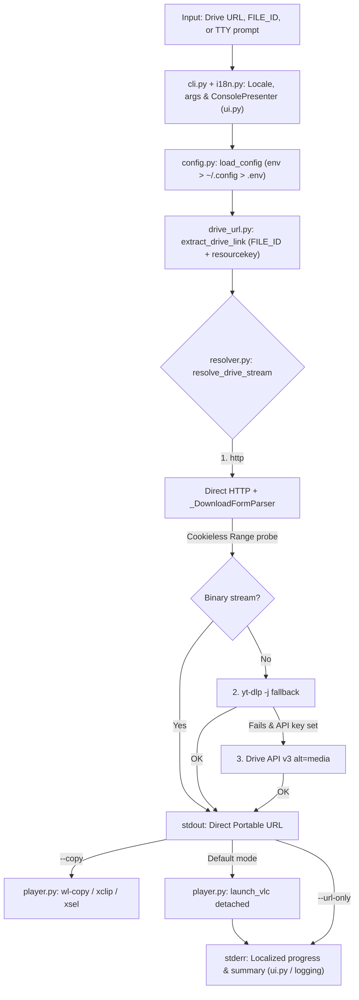

# 🚀 DriveStream VLC (`drive-vlc`)
> Lightweight pure-Python 3 CLI that turns public read-only Google Drive video links into portable direct streaming URLs and launches VLC in Linux.


---

## 👋 Welcome!
Welcome to **DriveStream VLC (`drive-vlc`)**! Whether you want to stream a shared Google Drive video straight into VLC without downloading gigabytes first, integrate a clean URL resolver into your Linux scripts, or contribute improvements to the codebase, we are glad you are here. Bug reports, ideas, and pull requests from the community are always welcome!

## 🎯 Project Overview
* 👁️ **Vision:** Provide a zero-dependency, portable Python 3 command-line tool that resolves public read-only Google Drive share links into standalone HTTP media URLs and launches VLC detached in Linux without running any local HTTP proxy.
* 📌 **Core Highlights:**
  * Zero external `pip` dependencies — runs anywhere via standard Python 3.12+.
  * Multi-backend cascade (`http` direct HTML/confirm parser → `yt-dlp` → optional Google Drive API v3) with cookieless verification so URLs stay portable.
  * Clean UNIX stream separation: `stdout` emits only the resolved URL while `stderr` carries status, warnings, and errors.

## ⚡ Main Features
* 💎 **Google Drive URL & ID Validator (`FEAT-01` / `FR-01`):** Accepts `/file/d/<ID>`, `/d/<ID>`, `open?id=<ID>`, `uc?id=<ID>`, `drive.usercontent.google.com`, or raw `FILE_ID` inputs while blocking folders and non-Drive domains.
* 💎 **Cascading Portable Stream Resolver (`FEAT-02` / `FR-02`, `NFR-02`):** Handles large-file virus-scan HTML forms, decodes UTF-8/RFC-5987 filenames (including Latin-1 mojibake recovery), detects private/quota walls, and verifies non-HTML streams without cookies.
* 💎 **Detached VLC Launcher & Clipboard Helper (`FEAT-03` / `FR-03`):** Launches `/usr/bin/vlc` detached (`start_new_session=True`) with `--network-caching=3000`, media title, and optional fullscreen or clipboard copy (`wl-copy`, `xclip`, `xsel`).
* 💎 **Layered Config & Scriptable CLI (`FEAT-04` / `FR-04`):** Loads optional configuration by precedence (`os.environ` → `~/.config/drive-vlc/.env` → `.env`) and supports `--url-only`, `--cache`, `-f`, `--copy`, `--method`, `--lang`, `--plain`, `--no-color`, and `-v`.
* 💎 **Linux System-Locale CLI Localization (`FEAT-05` / `FR-05`):** Automatically adapts CLI help, status, warnings, and errors to the Linux OS locale (`en` base fallback + `es`, or forced via `--lang`).
* 💎 **Interactive URL Prompt (`FEAT-06` / `FR-06`):** Invoking `drive-vlc` without arguments in an interactive terminal prompts for the Google Drive link or `FILE_ID` via `stderr` without polluting `stdout`.
* 💎 **Nala-Inspired Pure-Stdlib Terminal UI & Process Legends (`FEAT-07` / `FEAT-08`):** Renders Unicode rounded panels, ANSI colors, a threaded Braille spinner, and localized step-by-step progress legends on interactive `stderr`, respecting `NO_COLOR`, `--no-color`, and `--plain`.

## 🛠️ Getting Started & Installation
### 📋 Prerequisites
* Linux desktop/terminal environment (tested on Zorin OS / X11)
* Python `3.12+`
* VLC Media Player (`/usr/bin/vlc`)
* Optional: `yt-dlp` (fallback engine), `xclip`/`xsel`/`wl-copy` (for `--copy`)

### ⚙️ Installation

#### Option A — Standalone Release Executable (Recommended for End Users)
Download the single-file `drive-vlc` executable (a lightweight, zero-dependency Python 3 `zipapp` package built for any Linux system with Python `3.12+`) from **[GitHub Releases](https://github.com/seyerjo/DriveStream-VLC/releases)** — no repository clone required:

```bash
# 1. (Optional) Verify checksum with SHA256SUMS downloaded from the same release
sha256sum -c SHA256SUMS

# 2. Make executable and place it in ~/.local/bin
chmod +x drive-vlc
mkdir -p ~/.local/bin
mv drive-vlc ~/.local/bin/drive-vlc
```

#### Option B — From Source (Git Clone)
```bash
# 1. Clone the repository
git clone https://github.com/seyerjo/DriveStream-VLC.git
cd DriveStream-VLC

# 2. Make the entrypoint executable and symlink it into ~/.local/bin
chmod +x drive-vlc
mkdir -p ~/.local/bin
ln -sf "$(pwd)/drive-vlc" ~/.local/bin/drive-vlc

# 3. (Optional) Copy environment template if you want custom cache or API fallback
cp .env.example ~/.config/drive-vlc/.env
```

## 🚀 Quick Usage
```bash
# Interactive mode (prompts for the Google Drive link or FILE_ID)
drive-vlc

# Resolve a public Drive link, print the direct URL, and launch VLC in the background
drive-vlc "https://drive.google.com/file/d/YOUR_FILE_ID/view?usp=sharing"

# Print only the direct streaming URL without opening VLC
drive-vlc --url-only "https://drive.google.com/file/d/YOUR_FILE_ID/view?usp=sharing"

# Start VLC in fullscreen with a 5-second network cache
drive-vlc -f --cache 5000 "https://drive.google.com/file/d/YOUR_FILE_ID/view?usp=sharing"

# Plain logging output without styled panels/spinner or ANSI colors
drive-vlc --plain "YOUR_FILE_ID"

# Force a specific backend with verbose diagnostics
drive-vlc -v --method yt-dlp "YOUR_FILE_ID"

# Run the offline unit test suite
PYTHONPATH=src python3 -m unittest discover -s tests -v
```

## 🗺️ Workflow & Architecture


## 🤝 Contributing
Contributions, bug reports, and feature ideas are warmly welcome!
Please read our **[Contributing Guidelines](./CONTRIBUTING_GUIDELINES.md)** before opening an issue or submitting a Pull Request.

## ⚖️ Code of Conduct
We are committed to fostering an open, welcoming, and respectful community. All participants are expected to uphold our **[Code of Conduct](./CODE_OF_CONDUCT.md)**.

## 📄 License
This project is licensed under the **MIT** License — see the **[LICENSE](./LICENSE)** file for details.

## 📜 Changelog
Track project milestones and release notes in **[CHANGELOG.md](./CHANGELOG.md)**.

## 📚 Project Documentation
Access the consolidated project documentation inside `/docs`:
* 📘 **[Project Blueprint](./docs/01_project_blueprint.md):** Vision, functional/non-functional requirements (`FR`/`NFR`), and feature map.
* 🛠️ **[Engineering Guidelines](./docs/02_engineering_guidelines.md):** Technical architecture, tech stack justifications, and code style guide.
* 📋 **[Project Log](./docs/03_project_log.md):** Active prioritized task list (`To-Do List`) and development log.
