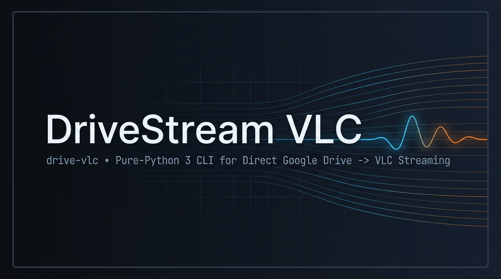
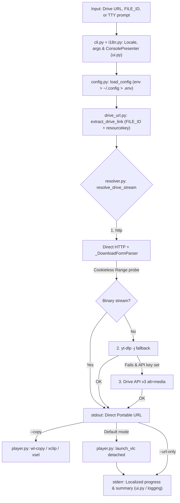

<div align="center">



# DriveStream VLC (`drive-vlc`)

**Lightweight pure-Python 3 CLI that resolves public Google Drive video links into portable direct streaming URLs and launches VLC detached in Linux.**

Zero external dependencies, cookieless stream verification, multi-backend fallback resolution, and strict Unix `stdout`/`stderr` separation for desktop playback and shell automation.

<p>
  <a href="#overview">Overview</a> ·
  <a href="#quick-start">Quick Start</a> ·
  <a href="#capabilities">Capabilities</a> ·
  <a href="#architecture">Architecture</a> ·
  <a href="#installation">Installation</a> ·
  <a href="#documentation">Documentation</a> ·
  <a href="#author">Author</a>
</p>

[](#architecture)
[](#documentation)
[](#license)
[](https://github.com/seyerjo/DriveStream-VLC/commits/main)

</div>

---

## Overview

Opening large shared Google Drive videos directly in VLC typically fails because Drive serves HTML virus-scan confirmation forms, redirects, or session-bound links instead of raw media bytes. Heavyweight wrappers often solve this by spawning a local HTTP proxy server or pulling in third-party runtime dependencies.

**DriveStream VLC (`drive-vlc`)** solves this with a zero-dependency, pure-Python 3.12+ standard-library CLI. It parses Google Drive sharing links and raw `FILE_ID` values, cascades cleanly through direct HTTP resolution, optional `yt-dlp` extraction, and optional Google Drive API v3 metadata/media endpoints, verifies candidates without cookies (`Range: bytes=0-0`) so URLs stay standalone and portable, prints only the resolved URL to `stdout`, and launches `/usr/bin/vlc` detached in the background.

## Quick Start

```bash
# Interactive mode (prompts on stderr for the Google Drive link or FILE_ID in a TTY)
drive-vlc

# Resolve a public Drive link, print the direct URL, and launch VLC detached
drive-vlc "https://drive.google.com/file/d/YOUR_FILE_ID/view?usp=sharing"

# Print only the direct streaming URL to stdout without opening VLC
drive-vlc --url-only "https://drive.google.com/file/d/YOUR_FILE_ID/view?usp=sharing"

# Start VLC in fullscreen with a 5-second network cache
drive-vlc -f --cache 5000 "https://drive.google.com/file/d/YOUR_FILE_ID/view?usp=sharing"

# Plain logging output without styled panels, spinner, or ANSI colors
drive-vlc --plain "YOUR_FILE_ID"

# Force a specific backend with verbose diagnostics
drive-vlc -v --method yt-dlp "YOUR_FILE_ID"

# Display localized CLI help
drive-vlc --lang en --help
```

**Expected Output (`drive-vlc --lang en --help`):**

```text
usage: drive-vlc [-h] [--url-only] [--cache MS] [-f] [--copy]
                 [--method {auto,http,yt-dlp,api}] [--lang {en,es}] [-v]
                 [--plain] [--no-color]
                 [url_or_id]

Resolve a public Google Drive link into a direct streaming URL and launch VLC
in the background.

positional arguments:
  url_or_id             Public Google Drive sharing link or video FILE_ID.

options:
  -h, --help            show this help message and exit
  --url-only            Print only the resolved URL to stdout without
                        launching VLC.
  --cache MS            VLC network cache in milliseconds (default: 3000 or
                        DRIVE_VLC_CACHE_MS).
  -f, --fullscreen      Launch VLC directly in fullscreen mode.
  --copy                Copy the resolved URL to the clipboard (requires
                        xclip, xsel, or wl-copy).
  --method {auto,http,yt-dlp,api}
                        Resolution backend to use (default: auto).
  --lang {en,es}        Force CLI output language (default: Linux system
                        locale, fallback: en).
  -v, --verbose         Emit diagnostic details via stderr logging.
  --plain               Disable styled Nala-like terminal UI and spinner on
                        stderr.
  --no-color            Disable ANSI colors in terminal output.
```

Run the offline unit test suite (`33` deterministic `unittest` cases):

```bash
PYTHONPATH=src python3 -m unittest discover -s tests -v
```

## Capabilities

- **Google Drive URL and ID Validation:** Extracts and validates `FILE_ID` values from `/file/d/<ID>`, `/d/<ID>`, `open?id=<ID>`, `uc?id=<ID>`, `drive.usercontent.google.com`, or raw IDs, propagates legacy `resourcekey` parameters, and rejects folder links and non-Drive domains.
- **Cascading Portable Stream Resolution:** Falls back automatically across `http` -> `yt-dlp` -> optional Drive API v3 (`GOOGLE_DRIVE_API_KEY`), parses virus-scan confirmation forms, recovers UTF-8/RFC-5987 filenames (including Latin-1 mojibake), falls back to viewer HTML `<meta property="og:title">` / `<title>`, detects login/quota blocks, and probes candidate URLs cookieless.
- **Detached VLC Playback and Clipboard Helper:** Spawns `/usr/bin/vlc` in a new session (`start_new_session=True`) with `--network-caching=3000` (configurable), `--meta-title`, optional `--fullscreen`, and optional clipboard copy via `wl-copy`, `xclip`, or `xsel`.
- **Layered Configuration and Unix Stream Discipline:** Resolves optional `.env` settings by precedence (`os.environ` -> `~/.config/drive-vlc/.env` -> repository `.env`) and keeps `stdout` strictly limited to the clean streaming URL while routing status, warnings, and errors to `stderr`.
- **Linux System-Locale Localization:** Detects OS locale (`LANGUAGE`, `LC_ALL`, `LC_MESSAGES`, `LANG`) using pure stdlib catalogs (`en` fallback and `es`), overridable via `--lang`.
- **Interactive Prompt and Styled Terminal Presenter:** Prompts on interactive `stderr` when `url_or_id` is omitted in a TTY, renders Nala-inspired rounded Unicode panels, ANSI accents, a threaded Braille spinner, and localized step-by-step progress legends, and downgrades cleanly to structured logging with `--plain`, `--no-color`, `NO_COLOR`, `TERM=dumb`, `--verbose`, or non-TTY pipes.

## Architecture



- **Core Stack:** Pure Python `3.12+` standard library (`urllib`, `html.parser`, `json`, `argparse`, `subprocess`, `dataclasses`, `pathlib`, `re`, `logging`) so `~/.local/bin/drive-vlc` executes globally without activating a virtual environment; native `/usr/bin/vlc` for playback; optional `yt-dlp` binary and Google Drive API v3 fallback.
- **Design and Reliability:** Decoupled `src/drive_vlc/` package architecture with strict PEP 585/604 type annotations, Google-style docstrings, `shell=False` subprocess invocation, structured diagnostic logs at `$XDG_STATE_HOME/drive-vlc/drive-vlc.log`, and `33` offline `unittest` tests using `unittest.mock`.

<details open>
<summary>Project Structure</summary>

```text
.
├── .github/
│   └── assets/
│       ├── avatar.png
│       └── banner.png
├── docs/
│   ├── 01_project_blueprint.md
│   └── 02_engineering_guidelines.md
├── src/
│   └── drive_vlc/
│       ├── __init__.py
│       ├── __main__.py
│       ├── cli.py
│       ├── config.py
│       ├── drive_url.py
│       ├── i18n.py
│       ├── player.py
│       ├── resolver.py
│       └── ui.py
├── tests/
│   ├── __init__.py
│   ├── test_config.py
│   ├── test_drive_url.py
│   ├── test_i18n.py
│   ├── test_player_and_cli.py
│   ├── test_resolver.py
│   └── test_ui.py
├── .env.example
├── .gitignore
├── CHANGELOG.md
├── LICENSE
├── README.md
└── drive-vlc
```

</details>

## Installation

### Prerequisites

- Linux desktop/terminal environment (tested on Zorin OS / X11)
- Python `3.12+`
- VLC Media Player (`/usr/bin/vlc`)
- Optional: `yt-dlp` (fallback engine), `xclip`, `xsel`, or `wl-copy` (for `--copy`)

### Option A — Standalone Release Executable

Download the single-file `drive-vlc` executable (a zero-dependency Python 3 `zipapp` package built for any Linux system with Python `3.12+`) from **[GitHub Releases](https://github.com/seyerjo/DriveStream-VLC/releases)**:

```bash
# 1. (Optional) Verify checksum with SHA256SUMS downloaded from the same release
sha256sum -c SHA256SUMS

# 2. Make executable and place it in ~/.local/bin
chmod +x drive-vlc
mkdir -p ~/.local/bin
mv drive-vlc ~/.local/bin/drive-vlc
```

### Option B — From Source

```bash
# 1. Clone the repository
git clone https://github.com/seyerjo/DriveStream-VLC.git
cd DriveStream-VLC

# 2. Make the entrypoint executable and symlink it into ~/.local/bin
chmod +x drive-vlc
mkdir -p ~/.local/bin
ln -sf "$(pwd)/drive-vlc" ~/.local/bin/drive-vlc

# 3. (Optional) Copy environment template for custom cache or API fallback
mkdir -p ~/.config/drive-vlc
cp .env.example ~/.config/drive-vlc/.env
```

## Documentation

- **[Changelog](./CHANGELOG.md):** Release history and version milestones.
- **[Project Blueprint](./docs/01_project_blueprint.md):** Vision, requirements, and feature scope.
- **[Engineering Guidelines](./docs/02_engineering_guidelines.md):** Architecture, tech stack, and code standards.

## License

Licensed under the **MIT** License — see **[LICENSE](./LICENSE)** for details.

## Author

<p>
  <a href="https://github.com/seyerjo">
    
  </a>
  <strong>Jose Miguel Reyes</strong><br />
  Senior IT Consultant, CTO/CIO, and Full Stack Developer focused on Data Analytics, AI, and clean software engineering.
</p>

<br clear="left" />

<p><em><strong>"Engineering for the future."</strong></em></p>

<p>
  <a href="https://github.com/seyerjo"></a>
  <a href="https://josemreyes.com"></a>
  <a href="https://www.linkedin.com/in/seyerjo"></a>
  <a href="https://x.com/seyerjo"></a>
  <a href="https://github.com/seyerjo/DriveStream-VLC/issues"></a>
</p>

> **Find this repository useful?** Consider giving it a star to support the project and bookmark it for future reference:
>
> [](https://github.com/seyerjo/DriveStream-VLC)
>
> Have a technical question or suggestion? Open an **[Issue](https://github.com/seyerjo/DriveStream-VLC/issues)**.
