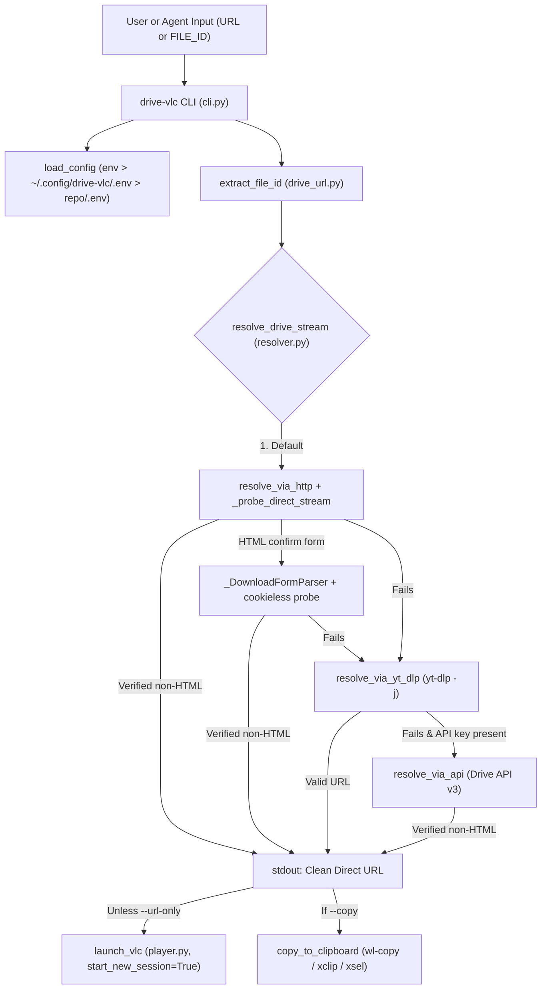

# Engineering Guidelines: DriveStream VLC (`drive-vlc`)

## Technical Architecture

The application follows a modular `src/` layout decoupling URL validation, layered configuration, stream resolution backends, process launching, and CLI orchestration.

### Module Responsibilities

- [`drive-vlc`](../drive-vlc): Executable symlink target (`~/.local/bin/drive-vlc`) that prepends `src/` to `sys.path` and calls `main()`.
- [`config.py`](../src/drive_vlc/config.py): Pure-stdlib `.env` parser and precedence resolver (`AppConfig`).
- [`drive_url.py`](../src/drive_vlc/drive_url.py): Drive URL parser, folder blocker, and `FILE_ID` validator.
- [`resolver.py`](../src/drive_vlc/resolver.py): Resolution backends (`http`, `yt-dlp`, `api`), HTML confirmation parser, `Content-Disposition` UTF-8 decoder, and cookieless stream probe.
- [`player.py`](../src/drive_vlc/player.py): Detached VLC subprocess launcher and Linux clipboard integration.
- [`cli.py`](../src/drive_vlc/cli.py): `argparse` CLI parser, exit code handling, and stream separation (`stdout` vs `stderr`).

---

## Tech Stack

- **Runtime:** Python `3.12.3` (standard library only: `urllib`, `html.parser`, `json`, `argparse`, `subprocess`, `dataclasses`, `pathlib`, `re`).
  - *Justification:* Eliminates `.venv` activation friction when invoked globally from `~/.local/bin/drive-vlc` across arbitrary directories or agent shells.
- **Media Player:** Native Linux VLC (`/usr/bin/vlc`), launched detached with `--network-caching=3000`.
- **Optional Fallback Engine:** Local `yt-dlp` binary (`~/.local/bin/yt-dlp`) and optional Google Drive API v3 (`GOOGLE_DRIVE_API_KEY`).
- **Testing:** Built-in `unittest` (`unittest.mock`) for deterministic offline verification (`PYTHONPATH=src python3 -m unittest discover -s tests -v`).

---

## Code Style Guide

All rules below are derived strictly from the active rule set in `.agents/rules/` (`global_instructions.md`, `global_git_rules.md`, `project_rules_python_console_and_scripts.md`, and `local_drive_vlc_constraints.md`):

1. **Language Separation:**
   - Conversational chat responses must be in **Spanish (Spain)**.
   - All repository filenames, source code, identifiers, comments, docstrings, documentation, and configuration files must be in **English** (CLI user-facing output uses English base messages localized to the Linux system locale per `FEAT-05`).
2. **Python Architecture & Typing:**
   - Keep `src/drive_vlc/` strictly in Python 3 standard library with zero external `pip` runtime dependencies (`local_drive_vlc_constraints.md` overrides `.venv`/`pyproject.toml` runtime dependency requirements).
   - Never introduce a local HTTP proxy server; all resolved URLs must remain portable HTTP links.
   - Use strict Python type hints on every function signature, parameter, and return type.
   - Use `argparse` with descriptive `help` strings for every argument and flag; never parse `sys.argv` manually.
3. **Docstrings & Error Handling:**
   - Document every module, class, public method, and operational function in English using **Google Python Style Docstrings** (`Args:`, `Returns:`, `Raises:`).
   - Intercept specific exceptions gracefully; never let raw tracebacks leak to end users.
   - Return explicit exit codes via `SystemExit(main())` (`0` on success, non-zero on failure).
4. **Console Streams & Event Logging:**
   - Reserve `sys.stdout` exclusively for primary data output (the resolved streaming URL).
   - Route operational alerts, warnings, and verbose diagnostic traces to `sys.stderr` using Python's native `logging` module (`TIMESTAMP - LEVEL - MESSAGE`) rather than raw debug `print()` calls.
5. **Security & Subprocesses:**
   - Pass command arguments as sanitized lists with `shell=False`; never use `shell=True`.
   - Never hardcode credentials or API keys; resolve secrets exclusively via environment variables or `.env` files.
6. **Git Workflow & Isolation:**
   - Use dedicated branches (`feature/*`, `fix/*`, `refactor/*`, `chore/*`) and Conventional Commits (`feat(scope): ...`, `fix(scope): ...`, etc.).
   - Never merge into `master`/`main` without explicit user confirmation; keep `.agents/`, `.vscode/`, and `.env` excluded via `.git/info/exclude` / `.gitignore`.
7. **Verification Gate:**
   - Run `PYTHONPATH=src python3 -m unittest discover -s tests -v` after any Python code edit.
